# Harness Bridge

**A working Telegram Bot case, with a callable OpenShell + DSH binding.**

The main example is [GroupWeave](examples/groupweave/README.md), a multi-tenant
Telegram application built around Koishi plugins and an existing DSH Agent.
Members use scoped code features or explicitly confirmed AI features; the host
application owns identity, permissions, storage, task lifecycle and Telegram
delivery. Flexible AI tasks run through the existing Docker/OpenShell path.

```text
Telegram / management Mini App
              ↓
GroupWeave: identity, group scope, confirmation, storage, delivery
        ┌─────┴─────────────────────────────┐
        ↓                                   ↓
Koishi / approved code               Harness Bridge → OpenShell + Docker
        │                                   ↓
        │                             DSH Agent + Skill
        └──────────── scoped text / media / task result ─────────→
```



The figure shows the library binding inside that larger application flow. It
does not show the GroupWeave receiver, product policy or delivery code.

## What is in this repository

- [`examples/groupweave/`](examples/groupweave/README.md) contains the full
  application example: Telegram/management entrypoints, Koishi and DSH
  integrations, storage, permissions and result delivery.
- [`createHarnessBridge(options).execute(request, signal?)`](index.mjs) remains
  a directly callable JavaScript library with TypeScript declarations. It
  connects a trusted host request to one fresh OpenShell Docker sandbox and an
  existing DSH headless Harness. It is a concrete binding, not a generic
  runtime or a separate product direction.
- [`examples/koishi/`](examples/koishi/README.md) remains a minimal, focused
  consumer showing the host-to-library seam.

GroupWeave reuses Koishi, grammY, Fastify, React/Vite, DSH, OpenShell, and
existing media, RSS, reminder and image tooling. The library does not own the
bot, its business rules, or a workflow engine.

## GroupWeave status

The copied source and its acceptance record describe a working bot case,
including group and private scopes, permissions and confirmation, Echo,
reminders, RSS, media and image features, Markdown rendering, and actual AI
tasks inside Docker. The 2026-10-29 record includes successful real `/brief`
and quoted `/digest` delivery through the configured provider path. Those
receipts apply to those tasks and do not establish all combinations or
production-wide guarantees. See the [fourteenth acceptance batch](examples/groupweave/docs/ACCEPTANCE-20261022-NATIVE.md).

Known gaps remain visible: anonymous site parsing is best-effort and some
remote samples fail; Console online plugin installation is not implemented;
AI sandbox file artifact return is not implemented; multi-turn memory and
broad plugin permissions are not implemented. The application record also
lists unverified combinations and deployment limits. See its [TODO](examples/groupweave/docs/TODO.md),
[acceptance](examples/groupweave/docs/ACCEPTANCE-20261022-NATIVE.md), and
[security notes](SECURITY.md).

## Run the local preview

Use Node.js 24+:

```sh
npm ci --ignore-scripts

cd examples/groupweave
npm ci
npm run build
APP_MODE=preview npm start
```

The app preview is available at `http://127.0.0.1:4318`. It uses preview
identities and does not need Telegram credentials or make real model calls.
The root suite exercises the bridge against a fake native CLI; the example's
own commands and evidence are documented in its README. A real Telegram
deployment requires its own credentials, HTTPS Mini App origin and bot setup.
Real AI execution also requires an existing OpenShell gateway/driver and
trusted DSH/provider configuration.

For the library alone, a host creates a bridge with its own trusted config and
callbacks:

```js
import { createHarnessBridge } from '@actweave/harness-bridge';

const bridge = createHarnessBridge(hostOwnedBridgeOptions);
const result = await bridge.execute(hostOwnedTrustedRequest, signal);
// The host checks current policy and audience before delivering any result.
```

The options and result contract are declared in [`index.d.ts`](index.d.ts).
GroupWeave's complete adapter is in [`examples/groupweave/src/server/sandbox-ai.ts`](examples/groupweave/src/server/sandbox-ai.ts).

## Boundary

The host owns authenticated identity, current permissions, persistence,
capacity, accounting and delivery. OpenShell owns sandbox lifecycle and DSH
owns its Harness behavior. The bridge submits one fixed native command and
returns bounded text and execution/cleanup evidence. It does not provide
Telegram APIs, arbitrary shell access, a model router, or file artifacts from
the sandbox.

The implementation uses OpenShell's Docker path and DSH headless only. A
completed Harness turn is not proof of model billing, business correctness or
user delivery. `modelRequestCount` remains unknown in the generic library.
Deployment policy and host-side checks remain part of the actual security
boundary. See [design](docs/design.md), [architecture](docs/architecture.md),
[ADR decisions](docs/adr/), and [validation](docs/validation.md).

## Documentation

- [GroupWeave application](examples/groupweave/README.md)
- [Minimal Koishi consumer](examples/koishi/README.md)
- [Design](docs/design.md) · [Architecture](docs/architecture.md) · [Roadmap](docs/roadmap.md)
- [Quickstart for the callable binding](docs/QUICKSTART.md)
- [Decisions](docs/adr/) · [Security](SECURITY.md) · [Validation](docs/validation.md)

[Apache-2.0](LICENSE).
