# Harness Bridge

**一个可运行的 Telegram Bot 案例，以及可直接调用的 OpenShell + DSH 接入库。**

主要示例是[群织 GroupWeave](examples/groupweave/README.md)：一个以 Koishi 插件和现有 DSH Agent
为基础的多租户 Telegram 应用。成员使用受范围约束的代码功能，或明确确认后调用 AI；宿主应用负责
身份、权限、存储、任务生命周期及 Telegram 结果交付。灵活的 AI 任务通过现有 Docker/OpenShell 路径执行。

```text
Telegram / 管理 Mini App
              ↓
GroupWeave：身份、群范围、确认、存储、结果交付
        ┌─────┴─────────────────────────────┐
        ↓                                   ↓
Koishi / 已批准代码                Harness Bridge → OpenShell + Docker
        │                                   ↓
        │                             DSH Agent + Skill
        └────────── 群/私聊范围内的文本、媒体与任务结果 ───────→
```



图片展示的是更大应用流程中的接入库绑定，不包含 GroupWeave 的接收入口、产品策略或交付代码。

## 仓库内容

- [`examples/groupweave/`](examples/groupweave/README.md) 是完整应用案例，包含 Telegram/管理入口、Koishi 与 DSH
  接入、存储、权限和结果交付。
- [`createHarnessBridge(options).execute(request, signal?)`](index.mjs) 仍是可直接调用并带 TypeScript 声明的
  JavaScript 库。它把可信宿主请求连接到每任务全新的 OpenShell Docker 沙箱和现有 DSH headless Harness。
  这是具体接入绑定，不是通用运行时或独立的新产品方向。
- [`examples/koishi/`](examples/koishi/README.md) 保留为精简、聚焦的宿主接入示例。

GroupWeave 复用 Koishi、grammY、Fastify、React/Vite、DSH、OpenShell 及现有媒体、RSS、提醒和图片工具。
接入库不拥有机器人、业务规则或工作流引擎。

## GroupWeave 当前状态

仓库中的完整源码和验收记录涵盖一个可工作的 Bot 案例，包括群聊与私聊范围、权限与确认、Echo、提醒、RSS、
媒体与图片、Markdown 渲染，以及在 Docker 内执行的真实 AI 任务。2026-10-29 验收记录包含真实 `/brief`
和引用 `/digest` 的执行及交付。这些收据只证明对应任务，不代表所有组合或生产级保证。详见
[第十四批原生验收](examples/groupweave/docs/ACCEPTANCE-20261022-NATIVE.md)。

2026-10-31 源码新增在线插件维护、每群工具开关、AI 配置提案、个人有界会话、任务历史、可信模型选择与固定
Markdown 沙箱产物。使用方式见[指南](examples/groupweave/docs/M1-M4-USAGE.md)。匿名站点解析仍是尽力服务；
完整命令、版本、启用条件与已验证结果见[功能速查](examples/groupweave/docs/FEATURE-CATALOG.md)，
部署与升级见[部署说明](examples/groupweave/docs/REPOSITORY-SETUP.md)。
[M5/M6 收尾](examples/groupweave/docs/CLOSEOUT-20261031.md)记录了部署复用与六个有界数据反例的结果和未测范围。
[后续补齐](examples/groupweave/docs/DEPLOYMENT-FOLLOWUP-20261031.md)完成了 Web 规则历史回滚、可选模型配置接线及默认 Docker 镜像完整构建/启动。
平台插件属于可信代码。源码实现、目标部署与真实 TG 交付分别记录，功能更新本身不等于线上验收通过。见其
[TODO](examples/groupweave/docs/TODO.md)、[当期交付记录](examples/groupweave/docs/DELIVERY-20261031.md)
和[安全说明](SECURITY.md)。

## 运行本地预览

需要 Node.js 24+：

```sh
npm ci --ignore-scripts

cd examples/groupweave
npm ci
npm run build
APP_MODE=preview npm start
```

应用预览地址为 `http://127.0.0.1:4318`，使用预览身份，不需要 Telegram 凭据，也不会发起真实模型调用。
根目录套件使用假的原生 CLI 检查接入契约；示例自身命令及证据见 GroupWeave README。真实 Telegram 部署需要
独立凭据、HTTPS Mini App 来源和 Bot 配置。真实 AI 执行还需要已配置的 OpenShell gateway/driver 和可信 DSH/provider 配置。

单独使用接入库时，宿主提供自己的可信配置和回调：

```js
import { createHarnessBridge } from '@actweave/harness-bridge';

const bridge = createHarnessBridge(hostOwnedBridgeOptions);
const result = await bridge.execute(hostOwnedTrustedRequest, signal);
// 宿主在交付前重新核对当前权限与接收范围。
```

选项和结果类型见 [`index.d.ts`](index.d.ts)。GroupWeave 的完整适配器位于
[`examples/groupweave/src/server/sandbox-ai.ts`](examples/groupweave/src/server/sandbox-ai.ts)。

## 边界

宿主负责已认证身份、当前权限、持久化、容量、计量和交付。OpenShell 负责沙箱生命周期，DSH 负责 Harness
行为。接入库提交一条固定原生命令，并返回有界文本及执行/清理证据；可选 `dsh.downloadResult` 在清理前取回
一个固定且经校验的 `result.md`。它不提供 Telegram API、任意 Shell 或模型路由。

当前实现只使用 OpenShell Docker 和 DSH headless。Harness 完成不证明模型计费、业务正确或用户已收到结果。
通用库中的 `modelRequestCount` 保持未知。实际安全边界仍包括部署策略及宿主检查。详见[设计](docs/design.md)、
[架构](docs/architecture.md)、[ADR](docs/adr/)和[验证记录](docs/validation.md)。

## 文档

- [GroupWeave 应用案例](examples/groupweave/README.md)
- [精简 Koishi 接入示例](examples/koishi/README.md)
- [设计](docs/design.md) · [架构](docs/architecture.md) · [路线图](docs/roadmap.md)
- [接入库 Quickstart](docs/QUICKSTART.md)
- [ADR](docs/adr/) · [安全](SECURITY.md) · [验证](docs/validation.md)

[Apache-2.0](LICENSE)。
