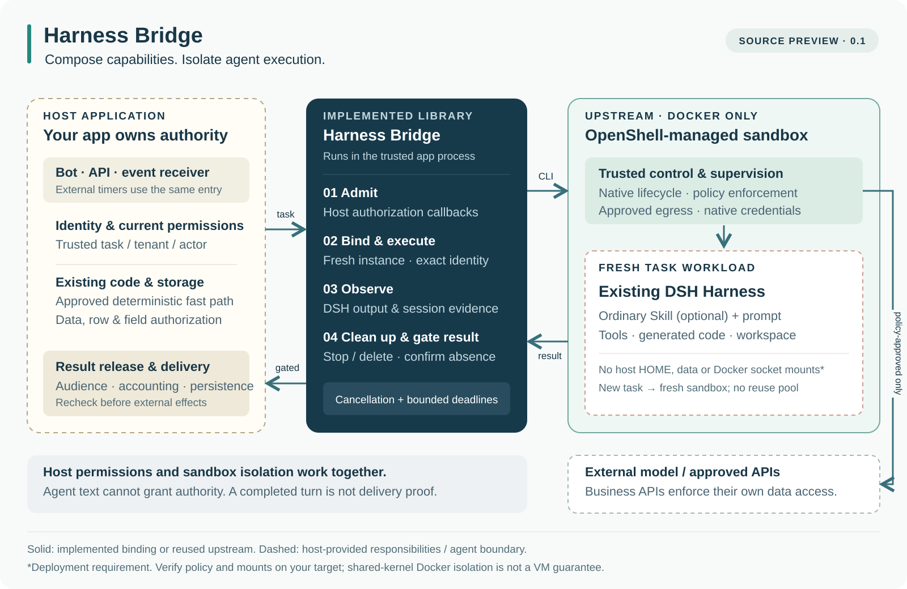

# Harness Bridge

**把可信应用接入隔离的 Agent Harness 执行环境。**

[English](README.md) · [接入指南](docs/QUICKSTART.md) · [设计](docs/design.md) · [ADR](docs/adr/) · [验证记录](docs/validation.md)

Harness Bridge 想验证一个简单的想法：**用普通 Skill 描述需要判断的方法，用可复用代码承接稳定任务，让现有系统完成实际工作。**
宿主应用掌握身份、数据与结果交付，现有 Harness 运行 Agent，现有隔离系统约束执行环境。

目前提供一个很薄的 JavaScript 接入库，把可信宿主请求连接到 **OpenShell 的 Docker 生命周期**和现有 **DSH headless Harness**。
TG Bot 是它的一种宿主，核心不依赖 Telegram 或 Koishi。

> **源码预览版 · `0.1.6-preview.1`**
> 当前提供具体接入实现和离线示例；部署准备和业务权限由宿主负责。
> 尚未达到生产 Bot 平台或跨任意 Harness 通用运行时的完整程度。



接入库在可信宿主进程内运行，OpenShell 为现有 Harness 提供每任务新建的执行环境。
存储、业务鉴权与用户交付仍由宿主负责。

[隔离边界与任务时序](docs/architecture.md) · [Mermaid 源码](assets/architecture.mmd) · [重新生成图稿](docs/diagrams.md)

## 核心思想

大量 AI 应用可以围绕四类已有能力组织：

| 部分 | 负责什么 | 实际归属 |
| --- | --- | --- |
| 接收端 | 接收消息、API 或外部事件，确认请求来源。 | 宿主应用 / 现有适配器 |
| 存储 | 保存配置、业务数据、任务历史和访问规则。 | 宿主应用 / 现有数据库 |
| Harness | 加载普通 Skill，需要时推理，调用工具并返回结果。 | 新沙箱内的现有 DSH |
| CLI / API 能力 | 执行真实操作，在实际数据与服务边界校验权限。 | 现有工具与服务 |

Harness Bridge 先用一个小而明确的接入模块把这些职责连接起来。
稳定、经过审核的操作沿用宿主代码路径；需要灵活判断的 Agent 任务交给隔离的 Harness。
高频方法可以经过开发、审核和测试成为代码。目前没有自动把 Skill 编译成代码的系统。

未来可以在应用层接入 JEV 等决策模型，从已授权能力中选择动作。
它是可选的应用策略，不是框架必须绑定的概念，也不是授权来源；当前接入库尚未实现它。

## 当前已经提供

- `createHarnessBridge(options).execute(trustedRequest, signal?)` 及 TypeScript 类型声明。
- 必需的宿主接纳、原生调用、结果释放鉴权回调。
- 每任务创建新 OpenShell 沙箱，核对原生 ID、随机名称、workspace 和归属标签。
- 可选上传普通 `SKILL.md`、宿主准备的 DSH patch；提示词通过 stdin 提交。
- 命令时限、输出上限、取消，以及独立时限内的停止、删除和消失检查。
- 分开记录执行与清理证据；清理不确定时阻止成功返回，不复用该实例。
- 薄 Koishi 接入示例：真实框架命令分发、模拟消息、按会话范围取消、有时限的退出等待。

当前绑定验证的是 **OpenShell CLI 0.1.3 的行为**与 **`@deepseek-ai/dsh@0.2.0-rc.2`**。
其他版本或 Harness 需要单独适配与验收。本实现只保留 OpenShell + Docker 一条隔离路径。

## 先跑离线示例

需要 **Node.js 24+**。包尚未发布到 npm。

```sh
git clone https://github.com/ailiheizi/harness-bridge.git
cd harness-bridge
npm ci --ignore-scripts
npm test

cd examples/koishi
npm ci --ignore-scripts
npm test
npm run demo
```

这些检查通过假的原生 CLI 和真实 Koishi App / Session / MockBot 验证接入契约，
不会启动 Docker、访问模型或发送真实 TG 消息。

真实应用接入方式：

```js
import { createHarnessBridge } from '@actweave/harness-bridge';
import trusted from './trusted-bridge-config.mjs';

const bridge = createHarnessBridge(trusted.bridge);
const result = await bridge.execute(trusted.task, trusted.abortSignal);

if (result.status !== 'completed' || result.cleanup.status !== 'verified') {
  await trusted.recordFailure(result);
} else {
  // 宿主在交付前再次校验计量、当前权限和接收范围。
  await trusted.checkAndDeliver(result);
}
```

`trusted` 由宿主应用实现，不是项目自带的服务。
可以用本地 `file:` 依赖把源码中的接入库加入另一个包。
[接入指南](docs/QUICKSTART.md) 列出了镜像、策略、patch、私有 CLI 配置和权限回调等前提。

## 隔离与管理边界

租户和操作者身份来自已认证的宿主状态，不能从提示词认领。
业务 API 必须校验行、字段、资源和操作权限，接入库回调不能代替这些检查。
只有经过批准的确定性代码放在可信宿主路径；生成代码与不可信代码在隔离工作负载内执行。

工作负载不应挂载宿主 HOME、业务数据或 Docker socket；模型凭据由原生可信配置管理。
这些都是实际部署需要满足并验证的条件，导入一个库本身不能证明它们成立。

`completed` 只证明预期 DSH 原生执行和接入库所检查的清理条件成立，
不代表业务结果正确、用户已经收到、或者计费准确。
`modelRequestCount` 始终是 `null`。
目前原生 CLI 按名称删除，仍有已记录的名称重绑定窗口；清理通过也不等于全部上游角色和卷已清空。
详见[安全说明](SECURITY.md)。

## 当前证据与缺口

| 检查 | 结果与范围 |
| --- | --- |
| 独立公开副本核心测试 | **46/46 PASS**；干净安装，假 CLI 与本地契约 |
| Koishi 示例 | **17/17 PASS**；配置 **10/10**、取消契约 **3/3**，均为离线检查 |
| 核心依赖审计 | 发布检查时 **0 个已知漏洞** |
| Koishi 依赖审计 | 存在传递依赖 `file-type` 的中危公告，见[依赖说明](docs/DEPENDENCIES.md) |
| 此前私有原生与真实模型实验 | 记录了 **3/3** 次固定合成输出往返；依赖私有准备，无法仅凭公开源码复现 |
| 生产多用户授权、真实交付、硬预算与重启恢复 | 本预览尚未证明 |

私有实验只提供背景，不能当作公开验收凭证。
[验证记录](docs/validation.md) 区分各层证据，[路线图](docs/roadmap.md) 列出扩大部署前的验收门槛。

## 文档与借鉴

- [核心设计](docs/design.md)、[架构与生命周期](docs/architecture.md)、[决策理由 ADR](docs/adr/)
- [接入指南](docs/QUICKSTART.md)、[Koishi 示例](examples/koishi/README.md)、[原生验收前提](docs/NATIVE-ACCEPTANCE.md)
- [依赖与限制](docs/DEPENDENCIES.md)、[贡献指南](CONTRIBUTING.md)

执行部分复用 [OpenShell](https://github.com/NVIDIA/OpenShell)、
[DSH](https://github.com/deepseek-ai/deepseek-harness)、[Execa](https://github.com/sindresorhus/execa)，
示例使用 [Koishi](https://github.com/koishijs/koishi)。
Mermaid 图稿参考了 OpenShell 的可信边界表达、OpenHands 的总览与细节分图及源码维护、n8n 的执行数据流、NanoClaw 的宿主与 Agent 分工，以及 C4 的职责标注。
[参考与差异](docs/references.md) 说明了具体借鉴范围，没有复制上游图像素材。

[Apache-2.0](LICENSE)。
