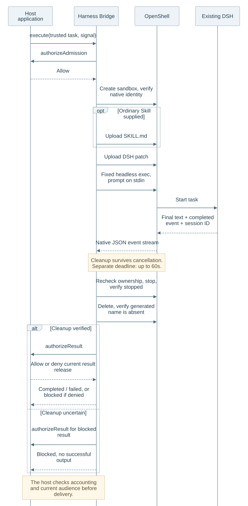

# Architecture

This preview has one concrete path: authenticated host application → bridge
library → OpenShell CLI → fresh Docker sandbox → existing DSH headless Harness.
Results return through the bridge to the host for its own policy, accounting,
and delivery decisions.

## System overview

The bridge is a library inside the trusted application process. OpenShell and
DSH are reused systems, not bridge-owned runtimes. The host keeps persistence,
business policy and delivery. The overview shows the main call and result
paths; it is not a physical deployment topology.

[Mermaid source](../assets/architecture.mmd)

## Isolation and authority boundary

The trusted host and OpenShell control/supervision sit outside the untrusted
Agent workload. The deployment must keep host HOME, business data and Docker
socket mounts out of that workload, and must verify native policy and egress
on the actual target. Docker uses the shared host kernel.

The optional business API is supplied by the host. It must enforce current
identity, operation, row, field and resource permissions itself. Its dashed
connection means an explicitly configured integration; it is not a tool or
authorization gateway shipped by this package. A bridge callback does not
intercept each DSH tool call. Network policy and business authorization are
separate controls.

[Mermaid source](../assets/isolation.mmd)

## Task lifecycle

This sequence illustrates an admitted task and its cleanup/result path.
Admission denial avoids native creation; create or execution failure enters
owned cleanup where possible. Partial creation requires conservative discovery
by the generated owner value. Unknown ownership must never authorize deletion
of an unrelated sandbox. Result authorization may deny any return, including
failure results; that produces a blocked result without output.

Cancellation or business permission revocation must not disable owned cleanup.
The cleanup window is separate and bounded; it is not a persistent recovery
service. A completed native turn and verified cleanup do not establish
accounting or delivery to a user.

[Mermaid source](../assets/task-lifecycle.mmd)

All three diagrams are generated by Mermaid CLI from the linked source files.
Do not edit SVG or PNG exports by hand. See [diagram maintenance](diagrams.md)
for the build command and [references](references.md) for design influences.

## Invocation sequence

1. The host builds `TrustedTaskRequest` from authenticated application state.
   Task, tenant, and actor identifiers must never come from prompt text.
2. The bridge freezes the standard request fields and calls
   `authorizeAdmission` before native work. The host remains responsible for
   current business policy and any persistent capacity/admission control.
3. The bridge invokes OpenShell with a generated name and ownership labels,
   then checks returned ID, name, workspace, and labels before upload or exec.
4. The bridge submits only its fixed DSH command. Prompt text is passed on
   stdin; caller-supplied shell commands or arbitrary environment variables
   are not part of the request API.
5. The bridge parses the DSH event stream, records final text/session/tool-call
   evidence, and attempts bounded cleanup. The host separately decides whether
   current permissions, trusted usage/accounting, and result audience allow
   release.

## Callback and authority boundary

`authorizeAdmission` is the host's task admission decision.
`authorizeNativeCall` runs before every business-phase native operation,
including `create`, `upload`, `exec`, and ordinary `get` identity reads (or
`list` if used in that phase). It is skipped only for owned cleanup-phase
`get`, `list`, `stop`, and `delete`. Cleanup uses
the native controller authority, a separate cleanup deadline, and bridge-owned
identity checks. `authorizeResult` is called before the result is returned to
the application. The host must still check any business action at its actual
data/API boundary and check the current recipient before user delivery.

## Native identity and cleanup

The bridge generates a random name and owner value and includes a hashed task
label. Before operations on a created sandbox, it reads the native record and
checks the expected ID, name, workspace, and labels. If create was attempted
but the response was lost, it searches by its unique owner label before
attempting cleanup; ambiguous discovery remains unverified.

The current CLI delete operation is name-based. A read immediately before
delete narrows but cannot remove the name-rebind race. The bridge reports
cleanup as verified only after stop is observed and a native list confirms the
owned name is absent. This is not a receipt that every external role, volume,
or backing resource has disappeared. Unknown identity or cleanup stays
`blocked`/`unverified`; the application must retain the record and must not
reuse the instance.

## Evidence scope

The API result distinguishes `execution`, `cleanup`, native exit code, DSH
session ID, and a tool-call event count. It always leaves
`modelRequestCount` unknown. Accounting and billing require a separate trusted
provider-side receipt with an exact task and sandbox binding. Application
success and delivery are host-owned outcomes.

The binding reuses OpenShell's Docker path only. It does not imply a second
backend, microVM, complete network-egress guarantee, or universal host
isolation. See [validation](validation.md) for what recorded tests establish.
