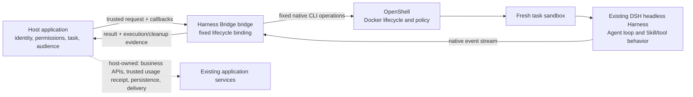

# Architecture

This preview has one concrete path: authenticated host application → bridge
library → OpenShell CLI → fresh Docker sandbox → existing DSH headless Harness.
Results return through the bridge to the host for its own policy, accounting,
and delivery decisions.

The original [SVG](../assets/architecture.svg) and [Mermaid source](../assets/architecture.mmd)
are kept with the code. Diagram design references are documented in
[references](references.md).

The dashed boundary is supplied by each host or target deployment; it is not
implemented by this library. OpenShell and DSH also have their own native
configuration and operational prerequisites. The diagram does not imply a
generic tool gateway, provider broker, network policy, or platform adapter in
the bridge.

## Invocation sequence

1. The host builds `TrustedTaskRequest` from authenticated application state.
   Task, tenant, and actor identifiers must never come from prompt text.
2. The bridge freezes the standard request fields and calls
   `authorizeAdmission` before native work. The host remains responsible for
   current business policy and any persistent capacity/admission control.
3. The bridge invokes OpenShell with a generated name and ownership labels,
   then checks returned ID, name, workspace, and labels before upload or exec.
4. The bridge submits only its fixed DSH command. Prompt text is passed on
   stdin; caller-supplied shell commands or arbitrary environment variables
   are not part of the request API.
5. The bridge parses the DSH event stream, records final text/session/tool-call
   evidence, and attempts bounded cleanup. The host separately decides whether
   current permissions, trusted usage/accounting, and result audience allow
   release.

## Callback and authority boundary

`authorizeAdmission` is the host's task admission decision.
`authorizeNativeCall` runs before every business-phase native operation,
including `create`, `upload`, `exec`, and ordinary `get` identity reads (or
`list` if used in that phase). It is skipped only for owned cleanup-phase
`get`, `list`, `stop`, and `delete`. Cleanup uses
the native controller authority, a separate cleanup deadline, and bridge-owned
identity checks. `authorizeResult` is called before the result is returned to
the application. The host must still check any business action at its actual
data/API boundary and check the current recipient before user delivery.

## Native identity and cleanup

The bridge generates a random name and owner value and includes a hashed task
label. Before operations on a created sandbox, it reads the native record and
checks the expected ID, name, workspace, and labels. If create was attempted
but the response was lost, it searches by its unique owner label before
attempting cleanup; ambiguous discovery remains unverified.

The current CLI delete operation is name-based. A read immediately before
delete narrows but cannot remove the name-rebind race. The bridge reports
cleanup as verified only after stop is observed and a native list confirms the
owned name is absent. This is not a receipt that every external role, volume,
or backing resource has disappeared. Unknown identity or cleanup stays
`blocked`/`unverified`; the application must retain the record and must not
reuse the instance.

## Evidence scope

The API result distinguishes `execution`, `cleanup`, native exit code, DSH
session ID, and a tool-call event count. It always leaves
`modelRequestCount` unknown. Accounting and billing require a separate trusted
provider-side receipt with an exact task and sandbox binding. Application
success and delivery are host-owned outcomes.

The binding reuses OpenShell's Docker path only. It does not imply a second
backend, microVM, complete network-egress guarantee, or universal host
isolation. See [validation](validation.md) for what recorded tests establish.
