# Reuse boundary

This page separates deployment preparation that can be shared from sandbox
instances that carry a task's writable state.

The upper panel is current behavior; the amber lower panel is a proposal.

## What happens today

`createHarnessBridge(options).execute(request)` authorizes admission, creates a uniquely
named OpenShell sandbox from the configured image, verifies its native
identity and ownership labels, optionally uploads one Skill, uploads the DSH
patch, and invokes one headless DSH turn. It then attempts bounded stop and
delete cleanup and verifies that the sandbox name is absent. This is one
fresh sandbox per task; there is no warm sandbox pool, VM pool, lease API, or
capacity manager in this package. See [ADR 0004](adr/0004-fresh-sandbox-cleanup.md).

| Stage | Input | Output / evidence | Current boundary |
| --- | --- | --- | --- |
| Admission | task, tenant, actor, prompt, requested providers | host authorization decision | Host owns identity and policy |
| Create | configured image, policy, workspace, resource request, owner/task labels | unique native sandbox identity | OpenShell Docker path |
| Prepare | optional `SKILL.md`, fixed DSH patch | files uploaded to that sandbox | Task-scoped writable environment |
| Run | prompt and headless DSH command | parsed session ID, final text, tool-call count, native exit code | One verified Harness turn |
| Cleanup | owned sandbox identity | stop observation and native name-absence evidence | Bounded cleanup; uncertainty is reported |

The bridge does not currently measure which image layers or dependencies the
container runtime caches, nor does it claim a cache-related performance gain.
Deployments may share immutable image layers and prebuilt dependency content
through their existing Docker/OpenShell mechanisms, subject to their own
validation. That shares prepared content, not a sandbox instance, writable
workspace, process, session, credential, or tenant state. The bridge does not
manage or promise those caches.

## Capacity reuse is a separate proposal

If measured startup cost later justifies it, the only candidate considered
here is a single-use lease of an unused, clean OpenShell-native prepared
capacity unit: claim it exclusively, run one task, destroy it, and replenish
clean capacity through native lifecycle operations. A failure or uncertain
identity/cleanup quarantines that capacity from further dispatch and keeps it
counted against host capacity until resolved. No dirty instance returns to
service after a wipe. Pause or resume preserves execution state and does not
prove reset to a clean state.

This candidate is **not implemented**. Investigation requires evidence that
the selected OpenShell version exposes native lifecycle operations and
identity/cleanliness signals sufficient for exclusive single-use claims,
destruction, replenishment, and failure isolation. A representative benchmark
must compare the current fresh-create/delete path with that exact native path,
including startup latency and total resource use. Until both the capability
and benchmark evidence exist, the accepted fresh-per-task lifecycle remains
the operating behavior.

The authenticated host application remains responsible for admission,
concurrency limits, and capacity decisions. Waiting or queueing, if needed,
belongs to an existing host service. This package will not add a pool service,
queue, scheduler, or second isolation backend; the isolation path remains
Docker-backed OpenShell.

## Claims and evidence

Claims about faster starts, cache reuse, warm capacity, or safe leases require
evidence from the actual pinned OpenShell and Docker deployment. Documentation
of a proposed lifecycle is not proof that the feature exists or is safe. See
[ADR 0006](adr/0006-clean-capacity-reuse.md) for the research gate.
