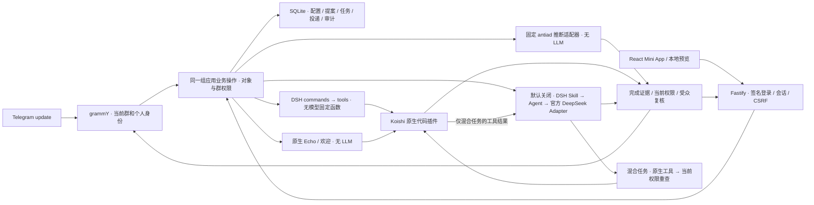

# 核心、架构与隔离

更新：2026-10-11；保留 2026-10-07 的核心权限、容量和恢复边界。GroupWeave 是独立 Telegram 应用。本文定义实现边界，
[DECISIONS.md](DECISIONS.md) 解释选择，[ACCEPTANCE.md](ACCEPTANCE.md) 保存当前实证。
离线测试通过不证明真实 Telegram、供应商、生产负载或任意插件完全安全。

当前已引入 Koishi 代码插件层，AI/Skill 使用 DSH 并能调用同一代码能力，
保留三类资格与群级治理。首个切片包括原生 Echo、链接插件和 AI→代码→AI 的
链接说明，现已补入群内 AI 命令/确认/取消、plaintext 欢迎、群助手及 opt-in
反广告纯预测；现有 grammY 唯一接收端保留。模块职责见 [MODULES](MODULES.md)。
实际绑定见[KOISHI-CODE-AI](KOISHI-CODE-AI.md)，
完整宿主迁移仍依[迁移验收](KOISHI-MIGRATION.md)推进。

## 产品与管理关系

平台维护随应用发布的已审查能力；群管理员为自己的群选择功能、调整允许参数，
先预览差异再启用；成员使用本群开放的能力。高频固定任务运行代码，需要语义
理解的任务才显式运行 Agent + Skill。群规则、用户文本和 AI 输出都不能授予权限。

actweave 仍只有根标准、workflow-to-skill 和 workflow-to-skill-with-surface。
身份、租户配置、SQLite、面板与容器属于外部 GroupWeave；代码插件归 Koishi，
Agent/Skill 与 AI 工具调用归既有 DSH。
不往 authoring 项目加入执行器、权限协议、队列、编译器、工作流图或通用插件平台。

平台管理员与群管理员是两种独立资格。平台 ID 来自部署白名单，只能启停全局
能力、查看不含群内容的全局审计与执行数据库维护；不会获得群成员资格。
真实群管理权来自 Telegram 当前查询。平台人员若另有群权，也须单独核验。
服务器、发布代码与数据库运维仍属于可信边界，能接触明文数据库和备份；
这里没有对主机运维提供端到端保密，也没有恶意 Node 插件沙箱。

## 按存储、接收端、Harness/代码与调用入口拆职责

用户进一步明确任务应按这几个已有部分拆开。职责分开，不要求拆成多个服务或
容器；原来的群聊/面板、Agent/Skill、代码能力三层体验继续保留。

| 部分 | 负责什么 | 当前对应 |
| --- | --- | --- |
| 存储 | 本群配置、授权版本、任务/投递与必要业务进度；AI会话使用Harness自己的实际持久化接口 | `store.ts` 的SQLite已接通；订阅/计划进度与跨请求AI会话仍未接通 |
| 接收端 | 接收TG/HTTP输入、取得可信上下文、提交普通消息或操作、呈现普通结果；时间触发也是一个接收来源 | `telegram.ts`、`telegram-binding.ts`、`app.ts`；时间接收尚缺 |
| Harness与代码 | 固定任务运行现成代码插件，语义任务运行既有Agent/Skill；提供真实结果、取消与完成证据 | `native.ts`、`ai.ts`、`koishi.ts`、具体`antiad.ts`适配 |
| CLI/原生调用入口 | 调用真实能力；命令名字不产生权限，不另建Agent循环、任务状态或通用Shell执行器 | DSH/Koishi目前用库原生API；实际进程入口是固定antiad worker和停机运维maintenance CLI |

TG消息、时间到期、外部事件都应进入同一已有授权及业务路径。可信群/个人/
目标、当前权限、功能范围、取消与交付检查在实际入口和能力边界强制，不因
换为CLI或后台触发而绕过。`actions.ts`是这些部分共用的普通业务函数，不成为
额外编排平台。运维CLI不作为群成员或AI的业务工具开放。

定时就是时间接收端唤起一次执行；持续就是存储保留有限进度，下一次输入
继续一次执行；组合就是普通代码函数或Skill调用已有能力。应用数据由现有
SQLite保存，Agent会话由原生Harness维护，避免复制两份会话历史和恢复逻辑。
当前DSH命令并非通用shell CLI，不能把SDK调用宣传成已存在的CLI子命令；
需要具体命令时复用确实存在的入口，缺失则记录适配缺口。
将来需要人工或自动化提交业务任务的CLI时，它只作为现有认证入口的薄客户端；
运行中的Store持有单owner锁，CLI不得另开同一数据库或直调插件来绕过在线权限。

## 现有宿主与一个容器

HTTP 与 TG 共用 `actions.ts` 的规则预览、版本比较和任务操作。这是普通应用业务
函数，不是工作流引擎或通用执行协议。界面不直接调用工具；面板配置不能写命令、
工具名、凭据、文件路径或执行代码。平台随版本增添已审查能力，群主组合功能列表，
不提供任意 DAG、在线插件下载或 Skill 自动编译安装。`telegram/product.ts`
使用 grammY 原生 Composer 管理有限命令/事件，`koishi-plugins` 使用原生插件
接口；antiad 是一个具体外部预测适配器，不是另一个通用工具执行平台。

固定路径每次创建新的原生 Session / idle Agent，只供 `commands.execute` 和
`tools.execute` 归属；无模型 turn、无 provider、无 HOME/profile 读取。
摘要、链接说明与群助手分别使用原生 SkillRegistry、Filesystem 和 ToolSkill
加载审核目录内的普通 SKILL.md，通过原生 AgentLoop 和官方 DeepSeekAdapter 执行。
精确接口见 [NATIVE-BINDING.md](NATIVE-BINDING.md) 与 [AI-BINDING.md](AI-BINDING.md)。

不为每群启动 Docker、进程或常驻 Agent。闲群只是数据库配置；活跃请求才创建
原生范围。反广告可选构建在同一服务中安装 Python，固定推断最多一个短
生命周期子进程，无额外常驻 bot/每群模型进程。容器约束整个应用，群隔离
主要由身份、对象、行、字段与受众检查落实，模型峰值另测。

## 身份入口

- `APP_MODE=preview`：只发布 loopback，使用服务器发放的不透明演示会话；
  合成群与个人独立命名空间。即使环境里存在 Token，也不启动真实 Bot。
- `APP_MODE=telegram`：明确配置 Bot Token 和独立平台 ID；grammY 读取可信 update。
  必须是群/超级群、普通个人发送者、Bot 当前为群管理员；匿名、频道与转发来源
  不成为群管理身份。每次群操作重新查询 `getChat` / `getChatMember`，失败拒绝。
- 面板使用 Telegram Mini App 原始 `initData`，由成熟库核验签名、最多 5 分钟
  新鲜度、未来时间及用户字段。签名只证明个人身份，不能证明群权。
  Cookie HttpOnly、SameSite=Strict，HTTPS 部署 Secure；最多 128 个会话、8 小时。
  修改操作验证精确 Host、Origin 与 CSRF，不信任 forwarded headers 或客户端角色。
- 真实成员表仅保存观察，不能替代当前查询。撤销或查询失败去除观察；实际请求
  仍重新核验。数据库内的 live 平台标记不能授予平台权限。

私聊 `/start`/`/help` 仅固定引导，不列群、不读群、不授群权，私聊业务/管理
尚未接入。注册只创建本群空间；群权限仍要重新核验。面板不枚举任意陌生群。TG 命令、
InlineKeyboard 确认、消息迁移与离线验证详见 [TELEGRAM.md](TELEGRAM.md)。

## 功能、对象、行与字段

| 维度 | 强制条件 | 真实限制 |
| --- | --- | --- |
| 功能 | 全局可用且启用、本群已配置、实际绑定存在 | 原生 guard；摘要无工具，助手/说明仅有限已绑定工具；AI 不授能力 |
| 对象 | 从真实提案、任务取得实际 groupId，再查询当前群权 | URL、提示词、callback data 不证明归属 |
| 行 | 本群任务记录；private 只给 creator；group 结果给本群成员 | SQLite 查询过滤与应用检查，未采用数据库原生 RLS |
| 字段 | 面板/任务记录的原始 input 字段仅 creator 可取；写入字段严格允许列表、Zod 校验配置 | 不隐藏已公开的TG命令/引用文本；先限制数据再交模型，不能先给 AI 再脱敏 |
| 管理 | 群 admin 可预览/启用；平台白名单可启停能力及维护 | 平台资格不推导群资格或他人私人结果访问权 |
| 审计 | 群审计只给当前本群 admin；全局只含 groupId=NULL 事件 | 不保存 input/output、凭据、任意 provider 错误文本 |
| 呈现 | 身份/群变化清空状态；异步结果绑定作用域 | BroadcastChannel 通知共享 Cookie 的标签清理；复制/截图无法撤回 |

当前输入是用户本次明确提交的文本。没有读取群历史、知识库、附件、其他群数据
或私密连接。group 结果本身可能包含原输入里的信息，提交者须理解分享影响。
新资源必须重新证明读取前的对象/行/字段和写入目标约束，旧测试不能自动覆盖。

## 规则与执行

自然语言规则采用有限解析，支持 @/命令、语言、链接、摘要、回显、链接说明、
欢迎、反广告、群助手开关，以及去重、排序和条数。欢迎模板与反广告阈值/词表
通过既有字段校验与同一种提案设置。未知要求进入 warnings，禁止启用；没有宣称 AI 理解任意规则。
面板精确调整也生成同一种提案。提案绑定群、创建者、基准版本与差异，启用重新
核验管理权并以 SQLite 事务比较版本；过期提案不覆盖其他管理员的新修改。

`responseMode` 决定 TG 自动触发：mention 要明确 @ Bot，command 要命令；显式
面板任务独立于自动监听策略。`language` 进入原生链接函数和 TG 回复，摘要也按
选定语言生成。功能列表、链接参数、欢迎模板与反广告规则都是本群配置，
不借其他群的默认值。欢迎由当前 `new_chat_members` 事件触发，使用已认证
发起者、当前群和事件显示名；只一遍替换 `{name}`/`{group}`，输出普通文本，
不解析显示名中的组件、表达式或指令。

每次任务必须完成以下约束：

1. 由可信会话/update 取得操作者，核验本群当前资格与实际功能状态。
2. 冻结本次输入、群、发起者、版本、参数和受众；用户不能选任意工具或目标。
3. 同群同发起者的重复保护键比较请求 hash；不同请求冲突，pending/unknown
   不重放，已清理正文返回 410，仍保留键以防重新执行。
4. 容量满在预留任务前返回 429，无队列；预留记录先于执行。
5. 原生入口按确切绑定执行。代码只接受零模型调用；摘要接受一次模型尝试，
   brief 接受两次模型与一次成功代码工具；助手接受 1 模型/0 工具或
   2 模型/1 成功工具。AI 均须本次绑定审核 Skill、非中断文本、
   原生 completed 与无错误；只生成一段文本不证明调用了插件。
6. 交付前重新检查会话、取消、群权、本群功能与平台状态。忽略 AbortSignal 的
   执行器迟到返回成功也不能交付；迁群后旧 scope 不能覆盖新的终态。
7. 历史与投递再检查归属/受众。TG 投递先原子 claim 再发送；sent/unknown/
   withheld 不重开。网络未知不能靠自动重发猜测恢复。

身份/权限查询与远端发送不是一个跨系统原子事务。最终核验后 Telegram 或平台
状态仍可能变化，无法撤回远端已接收的消息；不宣称无时间窗口或端到端 exactly-once。

## 代码与 AI 的成本边界

链接整理只在内存解析 URL，不抓取网页，不读文件或凭据；错误不会转给模型。
摘要、链接说明、群助手默认关闭，须部署 `ENABLE_AI=1` 与应用专用 Key，
再由平台开放、本群预览启用。每次输入另需明确确认发送给 DeepSeek；面板确认
是当次请求字段，TG 确认是本人原生按钮。签名绑定功能、本人、本群、源消息、
原 update、输入与触发方式，5 分钟过期；回调重读选中消息，变文/跨群/换人/
伪造/缺失/过期/重放拒绝。最多保存 512 条已消耗签名和过期时间，无输入副本；
满额拒绝消费，不驱逐有效记录。重建 adapter 换密钥，持久幂等仍防业务重跑。
回复主体只是本次数据，不把回复作者或提示词权限声明当成发起者资格。

AI 不读取群历史，不给模型 Shell、文件、HTTP、数据库或任意 Skill 选择工具。
固定模型 deepseek-flash，每次 dispatch 最多 1024 输出 tokens，摘要最多一次、
说明/助手最多两次；禁用原生重试，无自动 fallback。缺依赖就 blocked。

输入最多 8000 UTF-8 字节。用量来自原生 usage，未知为 null；超时尚无法取得
调用证据时调用数也为 null，不能填零。maxTokens 不是总金额或输入 token 硬限。
取消向上游传 signal 并等待真正 settle，不保证供应商停止计费。
原生 completed 证明生成流程结束，不证明摘要事实正确，用户仍需核对。

混合功能 link-brief 复用同一原生 Agent/Skill 机制；模型仅可调用无参数的
organize_links 一次，宿主按任务参数快照调用 Koishi 链接插件，再用真实代码
结果生成说明。它不新增宽工具；每次调用重新查本群资格和两个功能，最多
两次模型/两步，失败立即停止。群助手可以按本次目标直接回答，或在宿主
确认本群代码可用时选择同一工具一次；模型不能新增群、路径、参数或目标。
工具调用与已用工具任务的最终提交/TG 发送都重查链接依赖。Echo 和欢迎可
直接原生执行，输入不解析成命令选项或组件。
详细权限、用量及原生依赖边界见 [KOISHI-CODE-AI](KOISHI-CODE-AI.md)。

## 反广告适配与模型信任

`/scan`/面板复用用户已有 antiad 的纯预测模块，平台和本群仍需启用。
实际本地分类器加载与推断成功才可用；模型、依赖或 probe 缺失保持不可用/blocked，
没有 rule-only 假成功或 AI fallback。LLM 调用数为零，仍有真实本地 ML 推断成本。
当前仅判定 `allow/review/high-confidence-review` 建议，不自动删帖、禁言、封禁、
验证成员、处理申诉或训练模型，完整旧机器人业务尚未接入。

解释器、worker 和模型路径只来自可信部署，输入/群规则从 stdin 进入固定入口，
不通过 shell 或任意 argv。各次新建评分状态；群词表/阈值不改全局模型，不导入
旧生产数据库、全局管理员或跨群私有样本池。批准的共享只读模型须明确训练来源
与共享范围；joblib/pickle 能执行代码，不能接受群用户/AI 上传或选择。

同一应用服务的 [compose.antiad.yaml](../compose.antiad.yaml) 是 opt-in 构建，
默认不安装 Python。固定 Python 依赖、只读模型挂载、单个短进程有界运行，
取消/超时等待真正 close，不因此增加队列或每群容器。模型读取、分类质量、
峰值及长期成本另验；来源/具体接口见 [适配说明](../integrations/antiad/README.md)。

## 容量、数据和维护

- 单实例总活跃默认 2（可信部署可设 1–8），每群 1；代码与 AI 共用上限。
  等待超时后仍保留实际执行占用，直到执行器真正结束。
- 普通任务输入最多 16000 UTF-8 字节、200 行，输出最多 64000 字节，链接
  最多展示 100 条。链接扫描有界且协作取消，不将 timer 当硬抢占同步函数。
- 任务 10 秒等待到期请求取消；创建者可通过面板/API 或 TG `/cancel`/本人原生按钮取消本群活跃任务。
  注销、失效、
  功能撤销与关闭也传递取消。实际停止与外部副作用补偿必须按执行端证据判断。
- HTTP 使用 Fastify rate-limit 默认每 IP 120/分钟；TG 使用官方 ratelimiter
  每人 3/2秒、每群 10/2秒。速率限制与实际活跃限制是两回事。
- 每群保留 100 条任务正文、50 提案；全局 1000 审计。重复保护与投递键各
  最多 10000，满后拒绝新增，不删除旧键重开执行。SQLite 默认 32768 pages
  （4096 字节页时 128MiB 主库）；WAL、维护临时文件与备份另计。
- 备份最多 5 份、总 256MiB，不自动删除；原生 backup、完整性/schema 检查、
  hash 和无覆盖路径。备份进行中关闭会等待，后台维护失败不暴露内容。
- SQLite 原生独占锁确保一库一个运行 owner。重启 pending/claimed 转为未知，
  不自动重跑。不能多开进程共享 SQLite 来扩容。
- restore 只有固定运维 CLI，停机后以锁内事务复制已验证快照，不通过在线 API
  恢复或改 inode 绕锁。快照后的任务/投递键无法从旧备份重建，必须人工隔离
  更新并确认 point-in-time 切换；详见 [STORAGE.md](STORAGE.md)。

容器使用非 root、只读根、cap_drop、no-new-privileges，无 Docker socket；发布
loopback，512MiB/1CPU/128PID。限制不证明峰值、长期运行或目标服务器容量。
deployment host 先以总活跃 1 受控试验，再按实测调高；本轮未部署到服务器。

## 新插件的门槛与剩余验收

“插件小”只说明体积，不说明资源权限。少量代码也可能读取全库。当前共享进程
只加载平台随版本维护的可信代码；用户不能上传/下载执行插件。AI 代码审查可以
找问题、建议测试和风险分类，不能独自给出安全批准。

文件、网络、凭据、数据库、发布动作或不可信代码需要独立描述资源/对象/字段/
副作用边界，选择已有执行宿主或沙箱并验证。不能以增加一份 Skill 绕过门槛。
欢迎已是当前群明文模板插件和事件能力；提醒仍缺外部调度绑定，保持不可用，
落地时接已有调度能力，不自建通用调度器。原生插件不自动成为已隔离的任意
生态包；数据库/文件/凭据/网络旁路必须逐项审查，不能用 Skill 审查代替沙箱。

当前最重要的后续是：一个真实受控群的收发/降权/迁移验收，HTTPS Mini App
在 Telegram 的登录体验，明确启用后的真实摘要及用量核对，目标服务器负载与
故障恢复试验。它们尚未执行，不能被本机合成或离线 Bot API fixture 替代。

模块现状与后续门槛见 [MODULES](MODULES.md)。角色的实际使用旅程与 Koishi 借鉴依据见 [ROLE-EXPERIENCE](ROLE-EXPERIENCE.md)。
平台以插件维护为主；群管理员只管理本群；成员以群内命令和明确输入为主。
