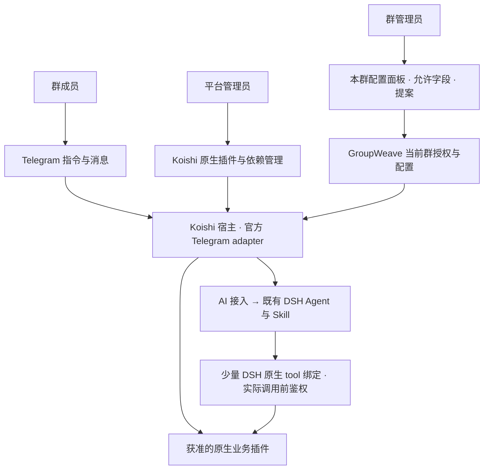

# Koishi 生态迁移切片与验收

日期：2026-10-07。状态：当前选定方向，首个代码层/混合切片已接入；完整宿主
集成待验证。实际已做范围与证据见 [KOISHI-CODE-AI](KOISHI-CODE-AI.md)。用户明确
直接引入 Koishi 做代码插件化，AI/Agent + Skill 按目标组合已允许的能力，
同一任务可以部分 AI、部分代码；保留平台/群管理员/成员三类产品入口。
原因与 Photon 比较见
[KOISHI-ECOSYSTEM-PHOTON](KOISHI-ECOSYSTEM-PHOTON.md)。

## 运行职责

这是外部应用采用现成宿主，图不定义新协议或工作流执行图。插件安装与原生
生命周期归 Koishi；平台准入、群委托、群配置版本与自有数据归 GroupWeave；
AI/Skill 执行归 DSH。普通插件直接原生运行；Agent 需要组合时，通过插件已有
命令或服务 API 的少量明确绑定调用同一代码能力，不重新实现插件业务。
不把 AI 限定成孤立的摘要插件，也不要求每次普通插件运行先经模型。

原生插件可自行访问数据、发送消息和启动后台活动；只有逐项验收的插件才能
进入群可用清单。GroupWeave 自有 actions 的检查不会自动包住任意第三方代码。

### 目标驱动的 AI 与代码组合

组合的可复用方法采用普通 Skill：写明目标、输入、现有能力、推荐步骤、判断
边界、恢复和真实成功证据。既有 Harness 运行 Agent；代码部分由现有 Koishi
插件执行。固定、高频的组合可以写成小型自有 Koishi 插件，只有需要判断或
生成的步骤才调用 AI。不建立固定 DAG、工作流引擎、通用工具协议或第二份
registry；不让 Skill 自己执行代码或拥有状态机。

每个需要 Agent 调用的能力先确认插件真实命令/服务、参数和结果约定。缺少
可调用入口的插件先原生使用，或做小扩展；“兼容 Koishi”不能证明“Agent
自动可调用”。命令调用还须绑定真实会话并保留插件自己的权限检查，不能用
伪造全局高权限 Session 绕过命令限制。

实际能力执行前，由服务端从可信会话取得租户与操作者，核验当前群角色、
插件启用状态、允许参数/字段、数据范围、目标和受众。Agent 工具参数不能
决定 tenantId 或角色，不能增加权限；规划或配置确认之后撤权，后续调用
必须拒绝。原生调用与 Agent 调用都使用相同的实际能力边界。

## 文件迁移范围

| 当前文件/组件 | 迁移选择 |
| --- | --- |
| server/store.ts | 保留群配置、CAS、自有任务/受众、幂等投递键、审计和备份；唯一 owner |
| server/actions.ts | 保留当前群授权与自有能力；给选择的命令/服务提供明确授权入口，不将两功能 runTask 变成通用插件执行器 |
| server/index.ts | 由一个 Koishi App 管理启动与销毁；创建唯一 Store/actions |
| server/telegram.ts、telegram-binding.ts | 接收与平台调用改接官方 adapter；保留可信来源、角色、迁群和确认校验 |
| server/app.ts | 初期保留 Fastify 签名登录/Cookie/CSRF/租户 API，同进程纳入生命周期 |
| server/native.ts | 暂保留已验证的自有链接能力，不作为所有生态能力入口 |
| server/ai.ts、audited/ | 复用 DSH Agent/Skill 接入，独立真实 Context/Session 与生命周期；明确绑定获准代码能力以支持同一任务混合执行 |
| client/main.tsx、request-scope.ts | 保留三类旅程、身份/群清理、跨标签变化与旧异步响应保护 |
| client/plugin-console.tsx、shared.ts | 能力来源转向原生已安装插件；只展示平台准入和可委托参数；不造新市场 |

Koishi Context 与 DeepSeek Cordis Context 不应混当同一对象。可以同进程组合
现成库，不等于重建 Harness 或每群常驻 Agent。

生态数据库插件不得同时打开现有独占的 GroupWeave SQLite 文件。初期可另用
一个 Koishi 数据库文件，检查其真实群键与查询；文件不同本身不证明权限隔离。
每个数据库仍须一个明确 owner，维护与备份范围分别落实。

## 配置只有明确的权威来源

- 包安装、依赖版本、宿主插件配置和原生运行状态由 Koishi 管理。
- 群资格、哪些插件/字段可委托、本群提案/CAS 由 GroupWeave 管理。
- 平台统一参数留在原生插件配置；群级覆盖从本群已批准版本产生，不另写一份
  可独立修改的群 YAML 与数据库互相覆盖。
- 群配置 CAS 提交和原生实例应用不是跨系统原子事务。必须分别记录“已确认”
  与“实际生效”；应用失败时阻止对应范围执行，报告未生效并恢复可核验版本。
  具体更新路径使用 Koishi 原生生命周期，不新增工作流引擎。

当前只读根容器不能直接在线 npm 安装。初期采用原生包、锁文件、镜像发布即
可吃插件生态；是否支持生产 Console 在线安装是另一个部署选择，需评估依赖
持久化、构建/重启与回滚，不能通过放开 Docker socket 或根目录绕过。

## 先验证一条生态闭环

1. 在独立试验目录与临时数据库准备 Koishi、官方 adapter、原生 Help 与一款
   已检查的简单消息插件。锁包版本，核对发布包和源码/许可。
2. 通过离线 adapter fixture 证明真实事件与身份映射，保留当前群成员实时查询。
   甲/乙两群；同一个人在甲群 admin、乙群 member，另一个平台用户无群权。
3. 证明一个**无需修改源码**的原生插件能用平台安装方式加载，群开启/关闭，
   成员经原生命令执行。不能只用 GroupWeave 自有四项功能冒充生态验证。
4. 另选原生 reusable/computed 的插件证明甲乙参数不同；不支持的样本必须诚实
   显示平台统一配置。Echo 可作跨目标权限探针，不直接普遍开放。
5. 选择一条具有实际命令/服务入口的代码能力，以 DSH 原生 tool 做少量绑定，
   证明原生命令与 Agent 调用执行同一能力。再用普通 Skill 验证一条包含代码
   操作和模型判断/生成的任务；规划、真实调用与成功证据分别报告。
6. 验证普通代码无模型开销、AI 具有独立工具/费用/授权限制；任务中平台停用
   或群撤权阻止后续调用，伪造群/角色/跨目标参数不能增权。
7. 验证通过再替换现有 TG 接入与目录，真实服务器部署和公网入口另行验收。

### 官方 adapter 已核验与仍要证明的部分

[Satori Telegram bot.ts](https://github.com/satorijs/satori/blob/c466fb01c5629a0d73f1c01205127b737b6fadd6/adapters/telegram/src/bot.ts)
的 getGuildMember 使用 getChatMember，可做当次身份查询；getGuildMemberList
实际只返回管理员，不是完整成员清单。
[utils.ts](https://github.com/satorijs/satori/blob/c466fb01c5629a0d73f1c01205127b737b6fadd6/adapters/telegram/src/utils.ts)
将 callback query 转成 interaction/button；仍需核验提案创建者、真实群、版本
和当前管理权。[message.ts](https://github.com/satorijs/satori/blob/c466fb01c5629a0d73f1c01205127b737b6fadd6/adapters/telegram/src/message.ts)
区分群 chat_id 与 topic message_thread_id，不能将话题 ID 当群租户 ID。

[polling.ts](https://github.com/satorijs/satori/blob/c466fb01c5629a0d73f1c01205127b737b6fadd6/adapters/telegram/src/polling.ts)
的连接/断开和 offset 处理与 grammY 不同。是否 drain 活跃 handler、迟到身份
是否被拒绝、失去投递结果后的恢复，都须重新验证，不能由旧 adapter 推断。

## 不能同时保留的重复路径

- 同一个 Bot Token 的 grammY 与 Koishi 更新消费者。
- 同一业务命令的两份活动 handler。
- 同一独占数据库文件的两个 owner。
- 平台原生配置与自建目录各有一份可互相覆盖的启停真相。
- 把 Koishi 原生插件再走另一套 Agent loop/provider router。

## 验收矩阵

| 范围 | 必须有的真实证据 |
| --- | --- |
| 原生生态 | 真正从原生包加载/配置/执行，不逐个重写；平台升级/停用/恢复可核对 |
| 混合执行 | 普通代码不经模型；Agent 从普通 Skill 经真实 DSH 绑定调用同一代码能力；缺少 API 的插件诚实标明不可组合 |
| 三类身份 | 群管理员不能调用全局 manager API/WebSocket；成员不能改配置；平台身份不推出群权 |
| 调用边界 | 模型不能指定租户/角色增权；每次实际调用检查当前授权；中途撤权、禁用及跨目标参数拒绝 |
| 每群配置 | 不同启用/支持的参数互不影响；CAS 冲突拒绝；原生配置应用失败不标生效 |
| 数据/目标 | 插件查询与后台输出的实际群范围；跨目标选项拒绝；私人内容不进入全局日志/面板 |
| 生命周期 | 卸载/热更新/撤权时停止所属活动；无重复注册、泄漏或未说明的迟到发送 |
| 接入 | 当前成员查询、匿名/转发拒绝、创建者确认、可信迁群、重复更新与未知发送 |
| 资源 | 真实插件依赖/实例/后台任务的 CPU/RSS/PID/磁盘与延迟；旧 115MiB 样本不作迁移预算 |

迁移前 112 项里 83 项覆盖 API、认证、管理、容量、客户端、存储与 DSH，自有
行为要求可沿用；29 项 TG adapter/生命周期/整合需要换成真实安装的 Koishi
组合验证。新增 Console 与生态插件的允许/拒绝、实例、数据、目标及资源检查。

若为了接入生态必须全量改成 DSH 工具、给群主全局 authority、或只有 filter
却无法说明数据库与目标范围，则本次闭环未达到目标，应记录缺口并缩小范围。
本页记载当前方向与完整迁移验收要求，不代替实施记录。首个原生插件和混合
执行切片已实现，离线全套 151 项 PASS；实现见
[KOISHI-CODE-AI](KOISHI-CODE-AI.md)，具体运行身份和证据见
[ACCEPTANCE](ACCEPTANCE.md)。完整 Telegram adapter/Console、真实模型和
Telegram、生产容量仍 **NOT RUN**，不能由首个切片推断完成。
