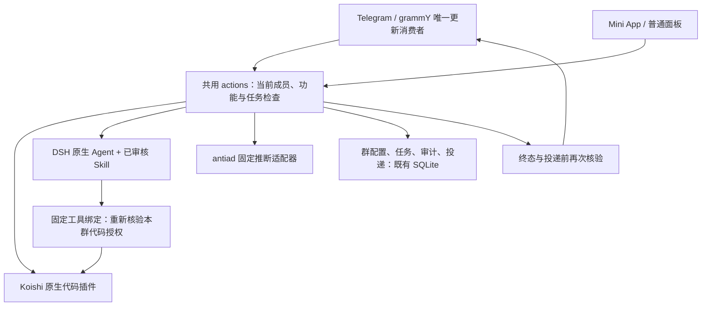

# Bot 模块与成熟度路线

日期：2026-10-11。本文定义当前实现和继续补齐的顺序；实际验证结果以
[ACCEPTANCE](ACCEPTANCE.md) 为准。当前是可继续演进的机器人实现，不能称为
已经完成线上验收的成熟服务。

## 使用体验先于插件数量

成员的主入口是 Telegram 群聊：`/help`、`/plugins` 发现本群可用功能，提交
命令或明确 @，收到进度、结果或明确失败；`/cancel` 取消本人本群任务。
私聊 `/start`、`/help` 提供上手指引，不凭一条私聊消息猜测管理目标群。
当前取消覆盖仍在执行的任务；执行终态后等待 Telegram 发送的结果没有取消
入口，该窗口仍可被平台/群功能撤权阻止。

群管理员 `/register` 后管理实际所在群，用 `/settings` 查看规则，`/rules`
预览后启用。面板辅助管理欢迎模板、链接参数和广告检测规则，修改仍产生同一
提案、比较同一版本。普通成员的面板只提供功能使用与本人可见记录。

平台管理员维护经过审查、随版本发布的能力及专用部署配置，再开放给各群。
平台开关不授予群管理权或群内容读取权。安装任意 npm 包、上传模型、选解释器
不属于群配置或模型提示词权限。

## 当前能力

| 模块 | 实际入口 | 执行方式 | 当前边界 |
| --- | --- | --- | --- |
| 链接整理 | `/links`、明确 @ 链接、面板 | DSH 无模型命令 → 自有 Koishi 原生插件 | 只处理当前文本；不打开链接 |
| 文本回显 | `/echo`、回复文本后命令、面板 | 未改源码的官方 `@koishijs/plugin-echo` | 身份、命令、参数和发送目标固定；命令式文本仍是文本 |
| 智能摘要 | `/digest`、回复文本后命令、面板 | 已审核 Skill → 原生 DSH Agent | 每次本人确认文本发送给 DeepSeek；一次模型尝试；无历史 |
| 链接整理与说明 | `/brief`、面板 | Skill → AI → `organize_links` → Koishi → AI | 两次模型尝试、一次实际代码调用；链接依赖须持续获准 |
| 群助手 | `/ask`、明确 @ 的目标、面板 | 原生 DSH Agent/Skill 按目标回答或选择同一代码工具 | 无工具为 1 模型/0 工具；用工具为 2 模型/1 工具；无群历史、网页或任意 Shell |
| 新成员欢迎 | Telegram `new_chat_members` | 自有 Koishi 原生文本插件 | 各群独立模板，只一遍替换 `{name}`/`{group}`；成员显示名不能变成消息组件或指令 |
| 反广告检测 | `/scan`、回复文本后命令、面板 | 用户既有 antiad 纯预测源码 → 固定有界 Python 入口 | 需要平台批准的只读基准模型；各群关键词/阈值独立；仅检测建议，不自动删封 |
| 提醒 | 无 | 尚缺外部调度绑定 | 保持不可用，不因目录占位就宣传为可运行 |

群内结果公开到发起群，保持所在话题；面板 `group` 是本群面板共享，尚不自动
推送到 Telegram，`private` 是本人面板结果。模型或评分输出都需要人工核对，
原生完成证据不证明答案事实准确或分类质量。

纯链接 @ 继续走零模型路径；含目标描述的 @ 优先已开放助手。缺助手时，
含链接输入仍尝试本群链接代码；无链接输入可进入已开放摘要的确认或功能指引。
每条路径仍检查本群实际启用与依赖，不因普通聊天自动读取历史或发起付费处理。AI 默认关闭；
平台配置、平台开放、本群启用、每次输入确认四个条件分别成立才会执行。

## 三层职责和一个执行入口



第一层是群聊与面板，第二层是已有 DSH 的 Agent/Skill，第三层是已有 Koishi
和外部代码能力。三层共用应用授权，不是三份权限系统。群来自可信请求上下文，
个人来自已核验身份；模型工具没有 `groupId`、`actorId`、路径或发送目标参数。

主要文件：

- `telegram.ts` 管理现有 grammY 生命周期与可信上下文；`telegram/product.ts`
  负责有限功能发现；`telegram/confirmation.ts` 负责原生按钮签名。
- `actions.ts` 是 API 与 TG 共用的鉴权、配置提案、执行、取消和终态入口。
  `telegram-binding.ts` 仅映射可信 TG 身份到这个入口。
- `koishi.ts` 管理现成 Context/Session；`koishi-plugins/links.ts` 和
  `koishi-plugins/welcome.ts` 是普通 Koishi 插件，官方 Echo 直接加载原包。
- `ai.ts` 组合现成 DSH Session/AgentLoop/Skill/ToolRuntime/Adapter；
  `mixed.ts` 把一个获准的原生代码能力绑定为明确工具，不新增工具注册平台。
- `antiad.ts` 与 `integrations/antiad/worker.py` 仅适配具体预测能力；
  [来源与接口](../integrations/antiad/README.md) 记录原文件 hash 和私有复用边界。

## 隔离必须覆盖插件实际读写的位置

配置、提案、任务、审计、取消、投递分别检查群及操作者。面板/任务记录对其他
成员隐藏发起者的原始 input 字段，private 结果只给发起者；group 结果仍可能
包含输入内容。Telegram 群内命令、选中的引用文本和机器人结果本来就对群公开，
这些字段检查不会使已公开消息变成私密，也不提供语义脱敏。平台身份不能绕过
应用检查。执行结束和投递
前重新核验，停用后重新启用也不能恢复被撤销的旧任务。

AI 原生确认按钮有 5 分钟时限，签名绑定功能、群、本人、源消息、原 update、
输入和触发方式。处理回调重读其回复的实际消息并验签，修改输入、跨群或换人
都不能沿用；最多保存 512 个已消耗签名，不保存输入副本，满额拒绝，重启旧
按钮失效。确认只授权该次文本，不成为长期群历史访问许可。

antiad 不复制原 bot 的数据库、生产模型、全局管理员、自动训练和处罚路径。
每次输入新建评分状态，各群关键词只是本次规则。共享只读基准模型必须明确
训练来源和共享范围；`joblib`/pickle 能执行代码，因此路径只由部署管理员
管理，模型不接受群用户或 AI 上传。旧模型包含跨群私有样本时不能直接共享。

**同进程 Koishi 插件属于受信代码，无法隔离任意恶意 npm 包。** 插件直接访问
数据库、Token、文件系统或网络时，入口鉴权无法替它限制那些旁路。准入须核验
实际资源访问，先限制权限或使用已有独立沙箱/执行服务；不能只靠 Skill 让 AI
看一眼就宣布安全。AI 代码审查可提供风险线索，准入依据仍是可复核代码、测试、
资源限制与必要的人工审核。

## 插件化到哪里

当前直接复用 Koishi 原生 `ctx.plugin`、Command、Session 和生命周期；不引入
一份 GroupWeave manifest/DSL、热装市场、DAG 或自建 AgentLoop。新增确定功能
写普通原生插件或固定外部适配器，再接现有鉴权和发现入口。只有需要 Agent
组合的能力才额外绑定 DSH 工具，普通代码不强制经模型。

当前没有完成 Koishi 官方 Telegram adapter、全局 Console 或任意生态插件
的无修改接入。官方 Echo 是已经验证的一例，不能推导所有插件的数据库、
网络、配置和全局发送目标都兼容多租户。迁移遵守
[KOISHI-MIGRATION](KOISHI-MIGRATION.md) 的单消费者、单数据库 owner 门槛。

默认仍是一个 Node 应用容器；欢迎和助手不为每群创建进程或常驻 Agent。
反广告构建是同一服务的 opt-in variant：默认不安装 Python，显式启用
`compose.antiad.yaml` 才安装锁定依赖并挂载受信只读模型，每次推断最多一个
短生命周期子进程。总任务容量仍由现有应用限制，不增加队列或 Redis。
内存限制不是实际模型峰值证明，生产容量须用批准模型测量。

## 机制级复用与组合目标（尚未接通）

用户进一步明确：复用的是共同机制，让不同组合形成能力。群功能启停清单不等于
这层组合。职责拆为存储、接收端、Harness/代码与CLI/原生调用入口，具体
归属见 [CORE](CORE.md)。时间触发属于接收来源，持续进度属于已有存储；
推荐保持普通函数与现有插件接口：

```text
时间 / 事件 / 新消息触发
→ 当前群授权与有限输入
→ 代码判断及执行；需要时调用既有 Agent/Skill
→ 保存本次必要进度
→ 复核权限后输出
```

同一机制可以组合成：时间＋文本输出＝提醒；时间＋取数＋汇总＝日报；
时间或外部事件＋取数＋变化判断＋通知＝监控；新消息＋原生会话恢复＋一轮
Agent执行＝持续助手。固定组合写普通代码插件，灵活选择使用已有 Harness；
这些例子是目标，不是当前已上线能力。

“持续”保留的是订阅/游标/有限会话进度，空闲不调用模型；每次被触发只做有界
工作。具体业务状态由该插件使用现有应用数据库或 Harness 原生持久化保存，
不抽出通用状态协议、事件总线、流程 DSL、DAG 或自建 Agent loop。

时间机制推荐评估 [Croner](https://github.com/Hexagon/croner) 的同进程 timer，
事件机制复用当前 grammY Composer 与可信 Telegram updates。多步成员交互
可评估 [grammY conversations](https://grammy.dev/plugins/conversations)，但其
replay 与存储边界必须验证，不能把会话等待当作精确定时。持续 AI 需接现成
Harness 的实际会话持久化/继续接口；当前每次 AI 请求仍创建独立原生 Session。

待实现边界：计划独立授权版本、每轮及投递前核验当前管理员、固定本群/topic
的无源消息投递、明确时区/错过时刻/重叠行为；不得伪造 TG update 或源消息。
暂停清除后续 timer，还须取消在途任务并阻止旧结果。无人值守 AI 需单独确认
输入来源、频率、有效期和模型预算，不能把一次文本确认沿用为无限授权。
无变化检查保存有限游标/计数，不无限增加完整任务和防重复键；真正业务执行
仍使用既有幂等与投递记录。以上没有新增已实现或已验证的运行能力。

## 成熟度验收顺序

1. **本地可审阅闭环**：命令、欢迎、AI 确认/进度/取消、两群配置、真实代码
   工具、反广告合成模型、依赖补丁、同一容器与页面。当前完成情况看 ACCEPTANCE。
2. **受控真实群**：专用 Token、两群管理员/成员、HTTPS Mini App 和专用模型
   凭据，实测降权/退群/Bot 移出/话题/重复回调/断网与恢复；不能用 fixture 替代。
3. **完整反广告业务**：借鉴原 bot 加入验证、举报、人工复核、私聊申诉和
   处置，案件主键/查询/管理员按钮都绑定群；原全局样本池不得偷偷重新接入。
   持久投递/处罚幂等与未知结果人工核对先于自动处罚。
4. **生态扩展**：根据群需求接一个实际有用的成熟插件，逐项验证多群参数与
   资源访问；再决定是否迁移官方 adapter/Console，而不是先增加所有平台功能。
5. **稳定运行**：批准模型下空闲/峰值/并发/磁盘配额、重启、备份恢复和长期
   观察通过后，才将状态写为生产验收通过。

仍缺：真实外部接入、完整反广告处置、提醒、群历史/知识库/附件、细化到成员或
角色/话题的可用范围、能力申请流程、任意插件准入及生产长期稳定证据。
这些有清楚的接缝和验证门槛，但不是本次已实现事实。
